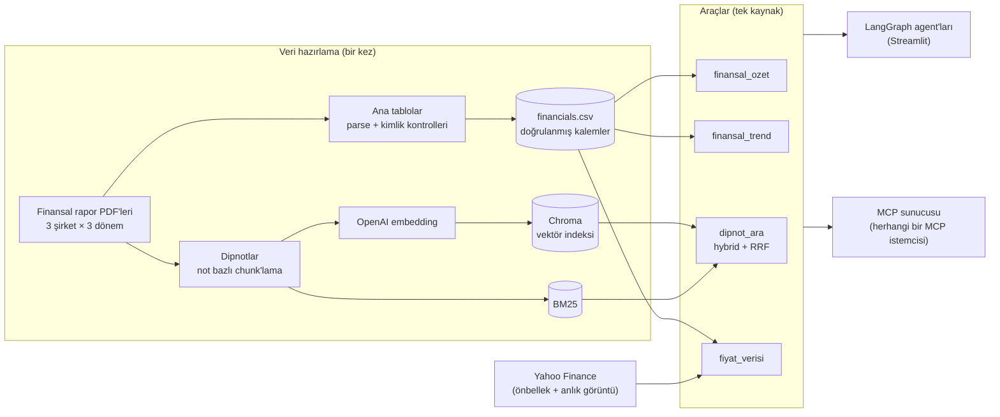
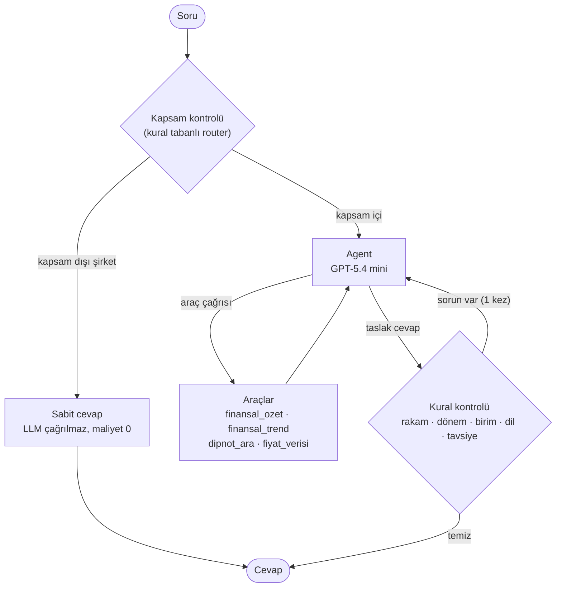
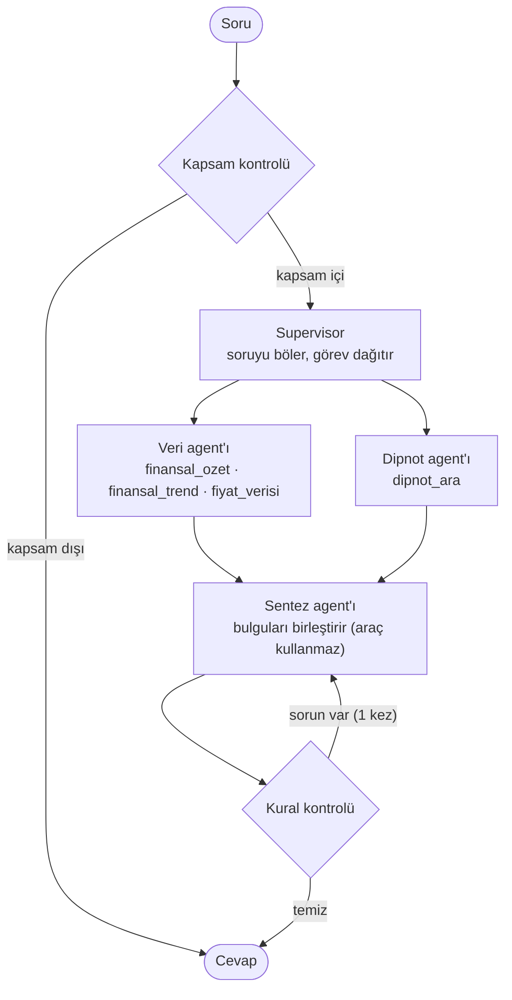

# 🔍 Mercek

**Finansal raporları sizin için okuyan yapay zekâ araştırma asistanı.**

Mercek; BİM, Tüpraş ve Aselsan'ın konsolide finansal raporlarını (2024 yıllık, 2025 yıllık, 2026 ilk 6 ay) ve hisse piyasa verisini analiz eder. Rakamları tablolardan **kodla hesaplar**, açıklamaları **dipnot ve sayfa numarasıyla** verir ve enflasyon muhasebesinin (TMS 29) dönem karşılaştırmalarına etkisini hesaba katar. İki mimariyle çalışır: **tek agent** (varsayılan) ve **multi-agent** (supervisor + uzman agent'lar).

> **Canlı demo:** `https://mercek.streamlit.app` ← *Streamlit Cloud adresinle değiştir*
>
> Tirendaz Academy AI Engineering Bootcamp final projesi. Eğitim amaçlıdır, **yatırım tavsiyesi değildir.**

---

## Ne yapabilir?

| Soru türü | Örnek | Nasıl cevaplanır |
|---|---|---|
| **Rakam ve oran** | "BİM'in 2025 brüt, esas faaliyet ve net kâr marjları nedir?" | Doğrulanmış tablolardan kodla hesaplanır |
| **Dönem karşılaştırması** | "Tüpraş'ın borçluluğu son üç dönemde nasıl değişti?" | Tüm dönemler aynı satın alma gücüne taşınır (TMS 29) |
| **Neden / nasıl** | "BİM kira yükümlülüklerini nasıl ölçüyor?" | Dipnotlarda hybrid arama, not ve sayfa atfıyla |
| **Kârlılık analizi** | "BİM'in kârlılığı 2025'te arttı mı, azaldı mı?" | Net kâr köprüsü farkı yaratan kalemi gösterir |
| **Enflasyon etkisi** | "Parasal kayıp olmasaydı vergi öncesi kâr ne olurdu?" | Parasal etki ve vergi etkisi ayrıştırılır |
| **Piyasa verisi** | "Aselsan'ın piyasa değeri, F/K ve PD/DD oranları nedir?" | Yahoo Finance fiyatı + kodla hesaplanan oranlar |
| **Karma** | "Borçluluk nasıl değişti ve dipnotlarda vade yapısı nasıl açıklanıyor?" | Rakam ve dipnot araçları birlikte |

Kapsam dışı sorular (başka şirketler), yatırım tavsiyesi istekleri ve prompt injection denemeleri ayrı katmanlarda yakalanır.

### Arayüz

- Sohbet arayüzü, hazır örnek sorular ve **mimari seçici** (tek agent / multi-agent)
- Canlı ilerleme durumu ("Supervisor görevleri dağıtıyor…", "Dipnotlarda aranıyor…")
- Her cevabın altında **Dipnot kaynakları** ve **Agent adımları** panelleri: hangi agent'ın hangi aracı hangi girdiyle çağırdığı, ne döndürdüğü ve kontrol katmanlarının neyi yakaladığı
- Oturum başına soru sınırı (public demo maliyet koruması)

---

## Mimari



Aynı araçlar hem Streamlit'teki LangGraph agent'larına hem de MCP sunucusuna hizmet eder: **tek kaynak, iki arayüz.**

### Tek agent (varsayılan)



### Multi-agent (`AGENT_MODE=multi`)



Uzmanlar gerektiğinde **paralel** çalışır; supervisor gerekmeyen uzmanı çalıştırmaz.

---

## Öne çıkan tasarım kararları

### 1. Hesabı kod yapar, LLM yorumlar
Finansal tablolar LLM'e okutulmaz. Ana kalemler PDF'lerden çıkarılıp **muhasebe kimlikleriyle** doğrulanır (toplam varlık = toplam kaynak, dönen + duran = toplam varlık, hasılat + maliyet = brüt kâr, ana ortaklık + kontrol gücü olmayan paylar = dönem kârı). 9 raporun tamamında kontroller tuttu. Oranlar, farklar, reel değişimler ve değerleme oranları Python'da hesaplanır. Model bir çıkarımda tutarsız kaldığında çözüm genellikle o çıkarımı araca taşımak oldu:

- **Net kâr köprüsü:** Dönem kârındaki değişimi esas faaliyet, parasal kazanç/kayıp, vergi ve diğer bileşenlerine tam olarak ayırır. Örneğin BİM 2025'te esas faaliyet kârı +9,01 milyar TL artarken parasal kazancın 10,10 milyar TL azalması net kârı düşürdü.
- **Parasal etki ayrıştırması:** "Parasal etki olmasaydı vergi öncesi kâr" ve vergi etkisi hazır hesaplanır.

### 2. Enflasyon muhasebesi (TMS 29) veriden çözüldü
Her rapor kendi tarihindeki satın alma gücüyle hazırlanır; farklı raporların rakamları doğrudan karşılaştırılamaz. Mercek enflasyon katsayılarını raporların karşılaştırmalı sütunlarından, yani **verinin kendisinden** türetir:

| Dönem | Katsayı | Üç şirkette |
|---|---|---|
| Aralık 2024 → Aralık 2025 | 1,3089 | birebir aynı |
| Aralık 2025 → Haziran 2026 | 1,1776 | birebir aynı |

Katsayıların üç farklı şirkette dört basamağa kadar aynı çıkması, sütun eşlemesinin doğruluğunun bağımsız bir kanıtıdır. `finansal_trend` tutarları bu katsayılarla Haziran 2026 satın alma gücüne taşır; borç/özkaynak gibi oranları ise düzeltmeden verir (pay ve payda aynı rapordan).

Farkın önemi: Tüpraş'ın finansal borcu raporlardaki nominal rakamlarla 18,99 → 68,20 milyar TL (3,6 kat) görünür; aynı satın alma gücünde ise 29,27 → 68,20 milyar TL, yani reel %133 artış.

### 3. Hybrid arama + bağlam başlıkları
- **Vektör arama** anlamı yakalar ("borç vadesi" → "kredilerin geri ödeme takvimi").
- **BM25** terimleri yakalar ("TFRS 16", "Eurobond"). Türkçe ekler için kelimelerin ilk 5 harfi kullanılır.
- İki liste **Reciprocal Rank Fusion** ile birleştirilir; aynı dipnottan en fazla 2 parça döner.
- Her parçanın başına `[Şirket | Rapor | Not N - Başlık]` bağlam başlığı eklenir; şirket ve rapor filtresiyle bilgi karışması önlenir.
- Dipnot parçalarında tablo sütun başlıkları kaybolabildiği için (cari yıl ile önceki yıl karışabilir) **toplam tutarlar dipnottan değil doğrulanmış tablolardan** alınır; dipnottan yalnızca kırılım ve nitel bilgi aktarılır.

### 4. Kritik kurallar prompt'ta değil kodda
Eval, modelin bazı kurallara "çoğu zaman" uyduğunu gösterdi. Bunlar koda taşındı:

| Katman | Ne yapar |
|---|---|
| **Router** | Kapsam dışı şirket sorularını LLM'e göndermeden cevaplar; yatırım tavsiyesi sorularında cevaba açık ret ifadesi garanti eder |
| **Rakam doğrulama** | Cevaptaki her rakam araç çıktılarında geçmeli (bin/milyon/milyar TL dönüşümleri dahil) |
| **Dönem kontrolü** | Sorudaki yıl cevapta geçmeli ve o yılın raporu gerçekten açılmış olmalı |
| **Birim kontrolü** | Dipnottaki bin TL tutarlarının "TL" diye yazılmasını yakalar (1.000 kat hata) |
| **TMS 29 notu** | Enflasyona göre düzeltilmiş tutar kullanıldıysa ve cevap bunu söylemiyorsa standart not eklenir |
| **Dil ve tavsiye** | Türkçe dışı alfabe ve al/sat/hedef fiyat dili |

Sorun bulunursa cevap geri bildirimle **bir kez** yeniden yazılır; sonsuz döngü yoktur.

---

## Değerlendirme (eval)

25 soruluk bir değerlendirme seti: rakam, trend, karşılaştırma, TMS 29, dönem, birim, dipnot (RAG), piyasa verisi, karma ve guardrail soruları. Beklenen değerler doğrulanmış tablolardan alınmıştır. Setteki birçok soru, geliştirme sırasında yakalanan **gerçek hatalardan** türetilmiş regresyon testidir (ör. yanlış dönemin cevaplanması, dipnot tutarının birimsiz yazılması, farklı raporların düzeltilmemiş tutarlarının yan yana konması). LLM'lerin rastgeleliği nedeniyle her soru **3 kez** çalıştırıldı.

### Deney 1: Reflection (LLM eleştirmen agent)
*23 soru × 3 tekrar, tek agent*

| Yapılandırma | Tam doğru | Ort. süre | Soru başı maliyet |
|---|---|---|---|
| **Eleştirmensiz** (kural katmanları aktif) | **67/69 (%97)** | **3,4 sn** | **$0,0077** |
| Nano eleştirmen | 60/69 (%87) | 7,8 sn | $0,0137 |
| Mini eleştirmen | 62/69 (%90) | 4,8 sn | $0,0121 |

**Bulgu: LLM eleştirmen doğruluğu artırmadı, düşürdü.** Başlangıçta gerçek hatalar yakaladı, ancak doğru cevapları da bozabildi (ör. "parasal kayıp net kârı azaltır" ifadesine yanlış itiraz). Yakaladığı hata türleri ucuz ve deterministik katmanlara taşındıktan sonra yalnızca yanlış alarm, gecikme ve maliyet ekledi. **Varsayılan olarak kapalıdır** (`CRITIC_ENABLED=1` ile açılabilir).

### Deney 2: Tek agent vs multi-agent
*25 soru × 3 tekrar, son sürüm*

| Mimari | Tam doğru | Ort. süre | Soru başı maliyet |
|---|---|---|---|
| **Tek agent** | **71/75 (%95)** | **3,6 sn** | **$0,0084** |
| Multi-agent (supervisor + veri + dipnot + sentez) | 69/75 (%92) | 8,1 sn | $0,0126 |

**Bulgu: Multi-agent bu görevde doğruluğu artırmadı; süreyi 2,2 kat, maliyeti 1,5 kat artırdı.** İki mimaride de her tekrarda başarısız olan soru yok. Geliştirme sırasında multi-agent'a özgü hata türleri görüldü: uzmanlar arası aktarımda bilgi kaybı (sentezde düşen açıklama veya tutar) ve iki uzmanın aynı kalem için **çelişen rakamlar** getirmesi. Bunlar araç ve prompt düzeltmeleriyle büyük ölçüde azaltıldı. Mimari arayüzde seçilebilir olarak duruyor; varsayılan tek agent.

> Her iki deneyde de fark küçük örneklemde ölçülmüştür ve istatistiksel olarak güçlü değildir; ancak süre ve maliyet farkları kesindir ve ek katmanların doğruluğa katkı sağladığına dair kanıt yoktur. Deney 1 ile 2'nin soru setleri ve kontrolleri farklı olduğundan oranları birbiriyle karşılaştırılmamalıdır.

```powershell
uv run python scripts/08_eval.py                                      # tek çalıştırma (varsayılan yapılandırma)
uv run python scripts/08_eval.py --configs yok,multi --tekrar 3       # tek agent vs multi-agent
uv run python scripts/08_eval.py --configs yok,nano,mini --tekrar 3   # eleştirmen deneyi
uv run python scripts/show_eval.py                                    # başarısız cevapları incele
```

---

## Piyasa verisi

`fiyat_verisi` aracı son kapanış ve tarihi, 1/3/12 aylık getiri, 52 haftalık aralık, piyasa değeri, **F/K** ve **PD/DD** verir.

- **F/K** = piyasa değeri / son 12 ay ana ortaklık net kârı. Son 12 ay kârı TMS 29'a uygun hesaplanır: 2025 yıllık kâr Haziran 2026 satın alma gücüne taşınır, 2026 ilk yarısı eklenir, 2025 ilk yarısı çıkarılır.
- **PD/DD** = piyasa değeri / ana ortaklığa ait özkaynaklar (30.06.2026).
- Piyasa değeri nominal ve güncel olduğu için oranların bir miktar yüksek çıkacağı çıktıda belirtilir. Oranlar "ucuz/pahalı" diye yorumlanmaz.
- Bulutta Yahoo erişimi engellenebileceği için veri sırasıyla önbellek → canlı istek → eski önbellek → repodaki anlık görüntüden gelir; her cevap verinin tarihini ve kaynağını söyler.

---

## MCP sunucusu

Mercek'in araçları **Model Context Protocol** üzerinden de sunulur; Claude Desktop, Cursor veya başka bir MCP istemcisi bağlanabilir.

| Tür | Ad | Açıklama |
|---|---|---|
| Araç | `sirket_listesi` | KAP `members` servisi karşılığı |
| Araç | `bildirim_listesi` | KAP `disclosures` karşılığı (finansal raporlar) |
| Araç | `bildirim_detay` | KAP `disclosureDetail` karşılığı (dipnot içindekiler, sayfa aralıkları) |
| Araç | `finansal_ozet`, `finansal_trend`, `dipnot_ara`, `fiyat_verisi` | Streamlit agent'ları ile aynı fonksiyonlar |
| Kaynak | `mercek://metodoloji` | TMS 29 yaklaşımı ve enflasyon katsayıları |
| Prompt | `sirket_analizi` | Yapılandırılmış şirket analizi şablonu |

```powershell
uv run python -m mercek.mcp_server        # sunucuyu başlat (stdio)
uv run python scripts/09_mcp_test.py      # gerçek bir MCP istemcisiyle test et
```

MCP Python SDK'nın 1.x (`FastMCP`) ve 2.x (`MCPServer`) sürümleriyle uyumludur.

### KAP adaptörü
KAP Veri Yayın Servisi'ne erişim; Borsa İstanbul ile veri dağıtım sözleşmesi, MKK'nın IP bazlı yetkilendirmesi ve API anahtarı gerektirir. Bu nedenle `mercek/kap.py` **adaptör kalıbıyla** yazıldı:

- `LocalKapAdapter`: elle indirilen raporlardan beslenir (demo bununla çalışır).
- `RemoteKapAdapter`: gerçek API için taslak. Uç nokta biçimi abonelikte iletildiğinden tahmin edilip yazılmamıştır; seçilirse açıklayıcı bir hata döner.

Gerçek erişim sağlandığında değişmesi gereken tek yer adaptördür (`KAP_ADAPTER=remote`).

---

## Veriden örnek bulgular

> Aşağıdaki rakamlar Mercek'in araçlarıyla hesaplanmıştır; yatırım tavsiyesi değildir.

- **BİM 2025:** Esas faaliyet kârı reel %130 artarken dönem kârı %23 düştü. Net kâr köprüsüne göre başlıca neden parasal kazancın 10,10 milyar TL azalması.
- **Enflasyon muhasebesi kârı iki yönde etkiliyor (2026 ilk 6 ay):** BİM'de parasal kazanç (17,64 milyar TL) vergi öncesi kârın %69,3'ü; parasal etki olmasaydı vergi öncesi kâr 25,46 yerine 7,82 milyar TL olurdu. Aselsan'da ise 6,40 milyar TL parasal kayıp var; parasal etki olmasaydı vergi öncesi kâr 12,65 yerine 19,05 milyar TL olurdu.
- **Tüpraş borçluluğu:** Finansal borç Haziran 2026 satın alma gücüyle 29,27 milyar TL'den 68,20 milyar TL'ye çıktı (reel %133), ancak net finansal borç üç dönemde de negatif (net nakit pozisyonu).
- **BİM'in finansal borcu büyük ölçüde kira:** 30 Haziran 2026 itibarıyla 62,59 milyar TL finansal borcun 61,85 milyar TL'si kira yükümlülüğü.

---

## Teknoloji

| Katman | Araç |
|---|---|
| Agent | LangGraph, LangChain |
| LLM | OpenAI GPT-5.4 mini |
| Embedding | OpenAI text-embedding-3-small (1536 boyut) |
| Vektör DB | Chroma |
| Anahtar kelime arama | rank-bm25 |
| Piyasa verisi | yfinance (Yahoo Finance) |
| PDF işleme | PyMuPDF, pymupdf4llm |
| Arayüz | Streamlit |
| Protokol | MCP (Python SDK) |
| Paket yönetimi | uv |
| Deploy | Streamlit Community Cloud |

---

## Proje yapısı

```
Mercek/
├── app.py                      # Streamlit arayüzü (mimari seçici dahil)
├── mercek/                     # uygulama paketi
│   ├── config.py               # ayarlar (.env'den okunur)
│   ├── financials.py           # oranlar, trend, net kâr köprüsü, TMS 29 katsayıları
│   ├── market.py               # piyasa verisi, F/K ve PD/DD
│   ├── retriever.py            # hybrid arama (Chroma + BM25 + RRF)
│   ├── textnorm.py             # Türkçe normalizasyon ve tokenizer
│   ├── tools.py                # agent araçları
│   ├── agent.py                # tek agent grafı, router, kural kontrolleri
│   ├── multi_agent.py          # supervisor + veri/dipnot uzmanları + sentez
│   ├── kap.py                  # KAP servis adaptörleri
│   └── mcp_server.py           # MCP sunucusu
├── scripts/                    # veri hazırlama ve test adımları
│   ├── 01_parse_test.py        # PDF'lerde ana tablo sayfalarını bul
│   ├── 02_extract_tables.py    # tabloları ayrıştır + muhasebe kimlik kontrolleri
│   ├── 03_build_financials.py  # sütun-dönem eşlemesi + TMS 29 katsayı kontrolü
│   ├── 04_chunk_notes.py       # dipnotları not bazlı parçala
│   ├── 05_build_index.py       # embedding + Chroma indeksi (önbellekli)
│   ├── 06_search_test.py       # BM25 / vektör / hybrid karşılaştırması
│   ├── 07_ask.py               # komut satırından soru (--multi ile multi-agent)
│   ├── 08_eval.py              # değerlendirme
│   ├── 09_mcp_test.py          # MCP istemci testi
│   ├── 10_export_index.py      # deploy için embedding dışa aktarımı
│   ├── 11_fetch_prices.py      # piyasa verisi anlık görüntüsü
│   ├── show_rows.py, show_eval.py
├── eval/sorular.json           # değerlendirme seti
└── data/
    ├── processed/              # financials.csv, chunks.jsonl
    ├── index/embeddings.npz    # bulutta indeks bu dosyadan kurulur
    └── market/snapshot.json    # piyasa verisi yedeği
```

---

## Kurulum

Gereksinimler: Python 3.12, [uv](https://docs.astral.sh/uv/), OpenAI API anahtarı.

```powershell
git clone https://github.com/tubakrc/mercek.git
cd mercek
uv sync
```

Proje kökünde `.env` dosyası oluştur:

```
OPENAI_API_KEY=sk-...
# Windows'ta proje yolu Türkçe karakter veya OneDrive içeriyorsa:
CHROMA_DIR=C:/mercek_index
```

Uygulamayı başlat:

```powershell
uv run streamlit run app.py
```

Repoda işlenmiş veri ve embedding dosyası bulunduğu için ilk açılışta Chroma indeksi OpenAI'a istek atmadan kurulur.

### Veriyi baştan üretmek

Ham PDF'ler repoda bulunmaz. Raporları KAP'tan indirip `data/raw/{bim,tupras,aselsan}/{2024_12,2025_12,2026_6}.pdf` düzeninde yerleştirdikten sonra:

```powershell
uv run python scripts/01_parse_test.py
uv run python scripts/02_extract_tables.py
uv run python scripts/03_build_financials.py
uv run python scripts/04_chunk_notes.py
uv run python scripts/05_build_index.py
uv run python scripts/10_export_index.py
uv run python scripts/11_fetch_prices.py
```

### Ayarlar (`.env` veya Streamlit Secrets)

| Değişken | Varsayılan | Açıklama |
|---|---|---|
| `AGENT_MODE` | `single` | `multi`: supervisor + uzman agent'lar (arayüzde de seçilebilir) |
| `AGENT_MODEL` | `gpt-5.4-mini` | Agent modeli |
| `EMBED_MODEL` | `text-embedding-3-small` | Embedding modeli |
| `CRITIC_ENABLED` | `0` | LLM eleştirmen (eval sonucuna göre kapalı) |
| `MAX_QUESTIONS_PER_SESSION` | `10` | Oturum başına soru sınırı |
| `CHROMA_DIR` | `data/index/chroma` | Chroma indeks klasörü |
| `PIYASA_TTL_SAAT` | `6` | Piyasa verisi önbellek süresi |
| `KAP_ADAPTER` | `local` | `remote`: gerçek KAP API (erişim gerektirir) |

---

## Sınırlar ve gelecek çalışma

- **Kapsam:** 3 şirket, 3 dönem, konsolide finansal raporlar. Faaliyet raporları ve yönetim yorumları kapsam dışıdır; bu yüzden "neden" sorularında Mercek yalnızca dipnotlarda yazanı aktarır.
- **Haber agent'ı:** Başlangıç planında vardı, uygulanmadı. Güvenilir ve kullanım koşulları uygun bir Türkçe haber kaynağı, telif ve haber metinleri üzerinden prompt injection riski çözülmeden eklenmesi doğru bulunmadı.
- **Veri erişimi:** KAP API erişimi olmadığından raporlar elle indirilmiştir. Piyasa verisi Yahoo Finance'ten gelir; resmî bir kaynak değildir.
- **Dipnot tabloları:** Parçalarda tablo sütun başlıkları kaybolabilir; bu nedenle toplam tutarlar dipnottan alınmaz.
- **LLM rastgeleliği:** Aynı soru farklı çalıştırmalarda farklı cevap verebilir; eval tekrarlı çalıştırılarak bu ölçülmüştür.

---

## Yasal uyarı

Mercek eğitim amaçlı bir projedir ve **yatırım tavsiyesi vermez**. Al/sat/tut önerisi ve hedef fiyat içermez; değerleme oranlarını ucuz/pahalı diye yorumlamaz. Kamuyu Aydınlatma Platformu, Borsa İstanbul veya ilgili şirketlerle bağlantılı değildir. Rakamlar şirketlerin kamuya açıklanan finansal raporlarından ve Yahoo Finance verisinden hesaplanmıştır; karar vermeden önce orijinal kaynaklarla karşılaştırın.
