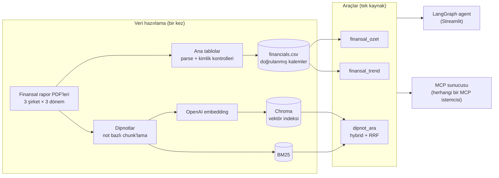
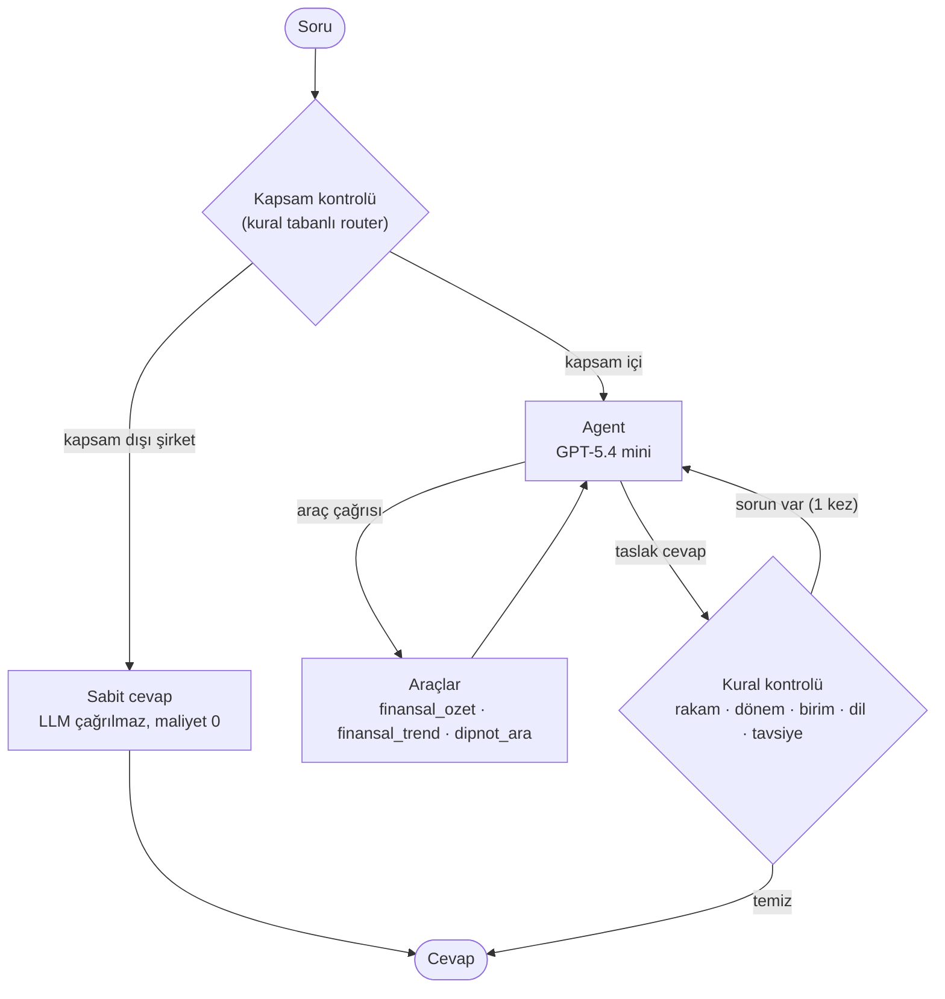

# 🔍 Mercek

**Finansal raporları sizin için okuyan yapay zekâ araştırma asistanı.**

Mercek; BİM, Tüpraş ve Aselsan'ın konsolide finansal raporlarını (2024 yıllık, 2025 yıllık, 2026 ilk 6 ay) analiz eder. Rakamları tablolardan **kodla hesaplar**, açıklamaları **dipnot ve sayfa numarasıyla** verir ve enflasyon muhasebesinin (TMS 29) dönem karşılaştırmalarına etkisini hesaba katar.

> **Canlı demo:** `https://mercek.streamlit.app` 
>
> Tirendaz Academy AI Engineering Bootcamp final projesi. Eğitim amaçlıdır, **yatırım tavsiyesi değildir.**

---

## Ne yapabilir?

| Soru türü | Örnek | Nasıl cevaplanır |
|---|---|---|
| **Rakam ve oran** | "BİM'in 2025 brüt, esas faaliyet ve net kâr marjları nedir?" | Doğrulanmış tablolardan kodla hesaplanır |
| **Dönem karşılaştırması** | "Aselsan'ın özkaynakları son üç dönemde nasıl değişti?" | Tüm dönemler aynı satın alma gücüne taşınır (TMS 29) |
| **Neden / nasıl** | "BİM kira yükümlülüklerini nasıl ölçüyor?" | Dipnotlarda hybrid arama, not ve sayfa atfıyla |
| **Karma** | "Tüpraş'ın 2026 ilk yarı hasılatı ne kadar arttı, dipnotlarda nedeni ne?" | Agent soruyu böler, iki aracı birlikte kullanır |
| **Karşılaştırma** | "Üç şirketin net kâr marjlarını karşılaştır." | Sektör farkı uyarısıyla birlikte |
| **Enflasyon etkisi** | "Parasal kazanç/kayıp olmasaydı vergi öncesi kâr ne olurdu?" | Parasal etki ve vergi etkisi ayrıştırılır |

Kapsam dışı sorular (başka şirketler), yatırım tavsiyesi istekleri ve prompt injection denemeleri ayrı katmanlarda yakalanır.

### Arayüz

- Sohbet arayüzü ve hazır örnek sorular
- Canlı ilerleme durumu ("Dipnotlarda aranıyor…", "Rakamlar doğrulanıyor…")
- Her cevabın altında **Dipnot kaynakları** ve **Agent adımları** panelleri: hangi aracın hangi girdiyle çağrıldığı, ne döndürdüğü ve kontrol katmanlarının neyi yakaladığı
- Oturum başına soru sınırı (public demo maliyet koruması)

---

## Mimari



Aynı araçlar hem Streamlit'teki LangGraph agent'ına hem de MCP sunucusuna hizmet eder: **tek kaynak, iki arayüz.**

### Agent grafı (LangGraph)



---

## Öne çıkan tasarım kararları

### 1. Hesabı kod yapar, LLM yorumlar
Finansal tablolar LLM'e okutulmaz. Ana kalemler PDF'lerden çıkarılıp **muhasebe kimlikleriyle** doğrulanır (toplam varlık = toplam kaynak, dönen + duran = toplam varlık, hasılat + maliyet = brüt kâr, ana ortaklık + kontrol gücü olmayan paylar = dönem kârı). 9 raporun tamamında kontroller tuttu. Oranlar, farklar ve reel değişimler Python'da hesaplanır; agent bunları araçtan alır.

### 2. Enflasyon muhasebesi (TMS 29) veriden çözüldü
Her rapor kendi tarihindeki satın alma gücüyle hazırlanır, bu yüzden farklı raporların rakamları doğrudan karşılaştırılamaz. Mercek, raporların karşılaştırmalı sütunlarından enflasyon katsayılarını **verinin kendisinden** türetir:

| Dönem | Katsayı | Üç şirkette |
|---|---|---|
| Aralık 2024 → Aralık 2025 | 1,3089 | birebir aynı |
| Aralık 2025 → Haziran 2026 | 1,1776 | birebir aynı |

Katsayıların üç farklı şirkette dört basamağa kadar aynı çıkması, sütun eşlemesinin doğru olduğunun bağımsız bir kanıtıdır.

### 3. Hybrid arama + bağlam başlıkları
- **Vektör arama** anlamı yakalar ("borç vadesi" → "kredilerin geri ödeme takvimi").
- **BM25** terimleri yakalar ("TFRS 16", "Eurobond"). Türkçe ekler için kelimelerin ilk 5 harfi kullanılır.
- İki liste **Reciprocal Rank Fusion** ile birleştirilir; aynı dipnottan en fazla 2 parça döner.
- Her parçanın başına `[Şirket | Rapor | Not N - Başlık]` bağlam başlığı eklenir; şirket ve rapor filtresiyle bilgi karışması önlenir.

### 4. Kritik kurallar prompt'ta değil kodda
| Katman | Ne yapar |
|---|---|
| **Router** | Kapsam dışı şirket sorularını LLM'e göndermeden cevaplar; yatırım tavsiyesi sorularında cevaba açık ret ifadesi garanti eder |
| **Rakam doğrulama** | Cevaptaki her rakam araç çıktılarında geçmeli (bin/milyon/milyar TL dönüşümleri dahil) |
| **Dönem kontrolü** | Sorudaki yıl cevapta geçmeli ve o yılın raporu gerçekten açılmış olmalı |
| **Birim kontrolü** | Dipnottaki bin TL tutarlarının "TL" diye yazılmasını yakalar (1.000 kat hata) |
| **Dil ve tavsiye** | Türkçe dışı alfabe ve al/sat/hedef fiyat dili |

Sorun bulunursa agent geri bildirimle **bir kez** yeniden yazar; sonsuz döngü yoktur.

---

## Değerlendirme (eval)

23 soruluk bir değerlendirme seti: rakam, trend, karşılaştırma, TMS 29, dönem, birim, dipnot (RAG) ve guardrail soruları. Beklenen değerler doğrulanmış tablolardan alınmıştır. Setteki birçok soru, geliştirme sırasında yakalanan **gerçek hatalardan** türetilmiş regresyon testidir.

LLM'lerin rastgeleliği nedeniyle her soru **3 kez** çalıştırıldı. Reflection kalıbının (LLM eleştirmen agent) katkısını ölçmek için üç yapılandırma karşılaştırıldı:

| Yapılandırma | Tam doğru | Ort. süre | Soru başı maliyet |
|---|---|---|---|
| **Eleştirmensiz** (kural katmanları aktif) | **67/69 (%97)** | **3,4 sn** | **$0,0077** |
| Nano eleştirmen | 60/69 (%87) | 7,8 sn | $0,0137 |
| Mini eleştirmen | 62/69 (%90) | 4,8 sn | $0,0121 |

**Bulgu: LLM eleştirmen doğruluğu artırmadı, düşürdü.** Eleştirmen başlangıçta gerçek hatalar yakaladı; ancak doğru cevapları da bozabildi (ör. "parasal kayıp net kârı azaltır" ifadesine yanlış itiraz). Yakaladığı hata türleri zamanla ucuz ve deterministik katmanlara taşındıktan sonra, eleştirmen yalnızca yanlış alarm, gecikme ve maliyet ekledi. Bu yüzden **varsayılan olarak kapalıdır** (`CRITIC_ENABLED=1` ile açılabilir).

> Yapılandırma başına 69 çalıştırmalık örneklemde fark istatistiksel olarak güçlü değildir; ancak yön iki eleştirmende de aynıdır, bazı sorularda bozulma tutarlıdır ve süre/maliyet artışı kesindir.

```powershell
uv run python scripts/08_eval.py                                  # tek çalıştırma
uv run python scripts/08_eval.py --configs yok,nano,mini --tekrar 3   # karşılaştırma
uv run python scripts/show_eval.py                                # başarısız cevapları incele
```

---

## MCP sunucusu

Mercek'in araçları **Model Context Protocol** üzerinden de sunulur; Claude Desktop, Cursor veya başka bir MCP istemcisi bağlanabilir.

| Tür | Ad | Açıklama |
|---|---|---|
| Araç | `sirket_listesi` | KAP `members` servisi karşılığı |
| Araç | `bildirim_listesi` | KAP `disclosures` karşılığı (finansal raporlar) |
| Araç | `bildirim_detay` | KAP `disclosureDetail` karşılığı (dipnot içindekiler, sayfa aralıkları) |
| Araç | `finansal_ozet`, `finansal_trend`, `dipnot_ara` | Streamlit agent'ı ile aynı fonksiyonlar |
| Kaynak | `mercek://metodoloji` | TMS 29 yaklaşımı ve enflasyon katsayıları |
| Prompt | `sirket_analizi` | Yapılandırılmış şirket analizi şablonu |

```powershell
uv run python -m mercek.mcp_server        # sunucuyu başlat (stdio)
uv run python scripts/09_mcp_test.py      # gerçek bir MCP istemcisiyle test et
```

MCP Python SDK'nın 1.x (`FastMCP`) ve 2.x (`MCPServer`) sürümleriyle uyumludur.

### KAP adaptörü
KAP Veri Yayın Servisi'ne erişim; Borsa İstanbul ile veri dağıtım sözleşmesi, MKK'nın IP bazlı yetkilendirmesi ve API anahtarı gerektirir. Bu nedenle `mercek/kap.py` **adaptör kalıbıyla** yazıldı:

- `LocalKapAdapter`: elle indirilen raporlardan beslenir (demo bununla çalışır).
- `RemoteKapAdapter`: gerçek API için taslak. Uç nokta biçimi abonelikte iletildiğinden tahmin edilip yazılmamıştır; seçilirse açıklayıcı bir hata döner.

Gerçek erişim sağlandığında değişmesi gereken tek yer adaptördür (`KAP_ADAPTER=remote`).

---

## Veriden örnek bulgular

> Aşağıdaki rakamlar Mercek'in araçlarıyla hesaplanmıştır; yatırım tavsiyesi değildir.

- **Enflasyon muhasebesi kârı iki yönde etkiliyor (2026 ilk 6 ay):** BİM'de parasal kazanç (17,64 milyar TL) vergi öncesi kârın %69,3'ü; parasal etki hariç vergi öncesi kâr 25,46 yerine 7,82 milyar TL olurdu. Aselsan'da ise 6,40 milyar TL parasal kayıp var; parasal etki hariç vergi öncesi kâr 12,65 yerine 19,05 milyar TL olurdu.
- **Tüpraş 2026 ilk yarı:** Hasılat geçen yılın aynı dönemine göre reel %42,8 arttı.
- **BİM'in finansal borcu büyük ölçüde kira:** 30 Haziran 2026 itibarıyla 62,59 milyar TL finansal borcun 61,85 milyar TL'si kira yükümlülüğü.

---

## Teknoloji

| Katman | Araç |
|---|---|
| Agent | LangGraph, LangChain |
| LLM | OpenAI GPT-5.4 mini |
| Embedding | OpenAI text-embedding-3-small (1536 boyut) |
| Vektör DB | Chroma |
| Anahtar kelime arama | rank-bm25 |
| PDF işleme | PyMuPDF, pymupdf4llm |
| Arayüz | Streamlit |
| Protokol | MCP (Python SDK) |
| Paket yönetimi | uv |
| Deploy | Streamlit Community Cloud |

---

## Proje yapısı

```
Mercek/
├── app.py                      # Streamlit arayüzü
├── mercek/                     # uygulama paketi
│   ├── config.py               # ayarlar (.env'den okunur)
│   ├── financials.py           # oranlar, trend, TMS 29 katsayıları (kodla hesap)
│   ├── retriever.py            # hybrid arama (Chroma + BM25 + RRF)
│   ├── textnorm.py             # Türkçe normalizasyon ve tokenizer
│   ├── tools.py                # agent araçları
│   ├── agent.py                # LangGraph grafı, router, kural kontrolleri
│   ├── kap.py                  # KAP servis adaptörleri
│   └── mcp_server.py           # MCP sunucusu
├── scripts/                    # veri hazırlama ve test adımları
│   ├── 01_parse_test.py        # PDF'lerde ana tablo sayfalarını bul
│   ├── 02_extract_tables.py    # tabloları ayrıştır + muhasebe kimlik kontrolleri
│   ├── 03_build_financials.py  # sütun-dönem eşlemesi + TMS 29 katsayı kontrolü
│   ├── 04_chunk_notes.py       # dipnotları not bazlı parçala
│   ├── 05_build_index.py       # embedding + Chroma indeksi (önbellekli)
│   ├── 06_search_test.py       # BM25 / vektör / hybrid karşılaştırması
│   ├── 07_ask.py               # komut satırından agent'a soru
│   ├── 08_eval.py              # değerlendirme
│   ├── 09_mcp_test.py          # MCP istemci testi
│   ├── 10_export_index.py      # deploy için embedding dışa aktarımı
│   ├── show_rows.py, show_eval.py
├── eval/sorular.json           # değerlendirme seti
└── data/
    ├── processed/              # financials.csv, chunks.jsonl
    └── index/embeddings.npz    # bulutta indeks bu dosyadan kurulur
```

---

## Kurulum

Gereksinimler: Python 3.12, [uv](https://docs.astral.sh/uv/), OpenAI API anahtarı.

```powershell
git clone https://github.com/tubakrc/mercek.git
cd mercek
uv sync
```

Proje kökünde `.env` dosyası oluştur:

```
OPENAI_API_KEY=sk-...
# Windows'ta proje yolu Türkçe karakter veya OneDrive içeriyorsa:
CHROMA_DIR=C:/mercek_index
```

Uygulamayı başlat:

```powershell
uv run streamlit run app.py
```

Repoda işlenmiş veri ve embedding dosyası bulunduğu için ilk açılışta Chroma indeksi OpenAI'a istek atmadan kurulur.

### Veriyi baştan üretmek

Ham PDF'ler repoda bulunmaz. Raporları KAP'tan indirip `data/raw/{bim,tupras,aselsan}/{2024_12,2025_12,2026_6}.pdf` düzeninde yerleştirdikten sonra:

```powershell
uv run python scripts/01_parse_test.py
uv run python scripts/02_extract_tables.py
uv run python scripts/03_build_financials.py
uv run python scripts/04_chunk_notes.py
uv run python scripts/05_build_index.py
uv run python scripts/10_export_index.py
```

### Ayarlar (`.env`)

| Değişken | Varsayılan | Açıklama |
|---|---|---|
| `AGENT_MODEL` | `gpt-5.4-mini` | Agent modeli |
| `EMBED_MODEL` | `text-embedding-3-small` | Embedding modeli |
| `CRITIC_ENABLED` | `0` | LLM eleştirmen (eval sonucuna göre kapalı) |
| `MAX_QUESTIONS_PER_SESSION` | `10` | Oturum başına soru sınırı |
| `CHROMA_DIR` | `data/index/chroma` | Chroma indeks klasörü |
| `KAP_ADAPTER` | `local` | `remote`: gerçek KAP API (erişim gerektirir) |

---

## Sınırlar

- **Kapsam:** 3 şirket, 3 dönem, konsolide finansal raporlar. Faaliyet raporları ve yönetim yorumları kapsam dışıdır; bu yüzden "neden" sorularında Mercek yalnızca dipnotlarda yazanı aktarır.
- **Veri erişimi:** KAP API erişimi olmadığından raporlar elle indirilmiştir.
- **Dipnot araması:** Uzun muhasebe politikası notlarında benzer paragraflar karışabilir; agent sonuç bulamazsa farklı terimlerle yeniden arar.
- **LLM rastgeleliği:** Aynı soru farklı çalıştırmalarda farklı cevap verebilir; eval tekrarlı çalıştırılarak bu ölçülmüştür.

---

## Yasal uyarı

Mercek eğitim amaçlı bir projedir ve **yatırım tavsiyesi vermez**. Al/sat/tut önerisi ve hedef fiyat içermez. Kamuyu Aydınlatma Platformu, Borsa İstanbul veya ilgili şirketlerle bağlantılı değildir. Rakamlar şirketlerin kamuya açıklanan finansal raporlarından hesaplanmıştır; karar vermeden önce orijinal raporlarla karşılaştırın.
